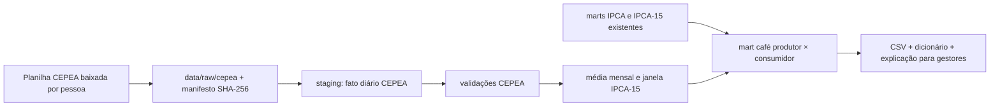

# Projeto (proposta): piloto do café — do produtor ao consumidor

- **Situação:** proposta para revisão do mantenedor. Nada implementado. Precisa de issue antes
  de qualquer código (regra de `AGENTS.md`).
- **Data do levantamento:** 04/11/2026.
- **Fontes:** IBGE/SIDRA (já no projeto) e CEPEA/Esalq-USP (fonte nova, não governamental).

## Pergunta do piloto

Como o preço do café pago ao produtor (indicadores CEPEA de arábica e robusta) se relaciona com
o preço do café pago pelo consumidor (IPCA e IPCA-15)? Em quanto tempo e em que proporção uma
alta ou uma queda na saca chega à gôndola e à xícara?

O café serve de piloto porque tem os dois lados bem medidos: um preço diário ao produtor com
história longa e subitens próprios e com peso relevante no IPCA. Se o desenho funcionar, ele se
repete para outros produtos com indicador CEPEA (arroz, feijão, leite, boi, frango, ovos,
mandioca, hortifrúti).

## O que já existe no projeto (lado do consumidor)

| Subitem | Código IBGE | IPCA | IPCA-15 | Observação |
|---|---|---|---|---|
| Café moído | 1114022 | jul/2006 → | mai/2000 → | peso 0,53% no IPCA em set/2026 |
| Café solúvel | 1114023 | jul/2006 → | mai/2000 → | peso pequeno (~0,01%) |
| Cafezinho | 1201009 | jul/2006 → | mai/2000 → | alimentação fora do domicílio; serviço |
| Café da manhã | 1201005 | até dez/2019 | até jan/2020 | descontinuado; não emendar |

Item-pai: 1114 Bebidas e infusões. Os quatro subitens são ligados como `identico` em todas as
trocas de POF nos mapas de harmonização; não há quebra a tratar no café, exceto a descontinuação
do café da manhã.

Leitura de set/2026 (IPCA): café moído −1,09% no mês, −16,19% no ano, −17,80% em 12 meses;
cafezinho +2,57% no mês e +9,76% em 12 meses. O descolamento entre o produto e o serviço já é
um achado do recorte.

## A fonte nova: CEPEA

| Indicador | Especificação (nota do CEPEA) | Unidade | Frequência |
|---|---|---|---|
| Café arábica CEPEA/Esalq | bica corrida, tipo 6, bebida dura para melhor, posto na cidade de São Paulo | R$ e US$ por saca de 60 kg líquido, à vista (prazo descontado pelo CDI) | diária, dias úteis |
| Café robusta CEPEA/Esalq | tipo 6, peneira 13 acima, 86 defeitos, a retirar na origem (ES) | idem | diária, dias úteis |

A página publica, por dia, valor em R$, variação no dia, variação no mês e valor em US$. A
variação no mês é ponto a ponto contra o último dia útil do mês anterior (em 03/11/2026 ela é
igual à variação do dia). Isso dá uma identidade para testar a nossa leitura.

**Três restrições encontradas no levantamento:**

1. **Sem API.** As séries históricas ficam em páginas de série e na consulta ao banco de dados
   do site; não há serviço oficial de dados.
2. **Acesso automatizado indesejado.** O `robots.txt` do CEPEA (gerado em 03/09/2026) bloqueia
   crawlers e agentes de IA, inclusive os da Anthropic, e as páginas de série respondem 403 a
   clientes automatizados. **O pipeline não deve raspar o site**, nem pelo GitHub Actions nem por
   agente. Contornar o bloqueio não é opção.
3. **Licença CC BY-NC 4.0.** Os dados do CEPEA podem ser redistribuídos com atribuição e para uso
   não comercial. Os dados derivados do projeto são CC BY 4.0 (`LICENSE-DADOS.md`), que permite
   uso comercial: o que contiver dado CEPEA precisa sair com licença própria, BY-NC.

## Decisões necessárias antes da implementação (proposta de ADR 0009)

| # | Decisão | Proposta | Alternativas |
|---|---|---|---|
| D1 | Aceitar fonte não governamental | Sim, como exceção documentada: não há equivalente oficial com preço diário ao produtor por tipo de café. Avaliar Conab (preços ao produtor) como fonte oficial complementar | Esperar fonte oficial; usar só Conab |
| D2 | Como obter os dados | **Download humano** da planilha no site, versionada em `data/raw/cepea/` com manifesto (data, pessoa, URL, SHA-256). Atualização mensal manual, por PR | Pedir ao CEPEA autorização formal ou acesso por convênio; assinar o boletim |
| D3 | Licença dos derivados | Marts com dado CEPEA sob CC BY-NC 4.0, com nota em `LICENSE-DADOS.md` e no dicionário; marts do IBGE seguem CC BY 4.0 | Não publicar o dado CEPEA, só indicadores agregados (continua sendo obra derivada) |
| D4 | Média mensal do produtor | Média aritmética dos dias úteis com cotação; para o IPCA-15, média na janela de coleta (dia 16 do mês anterior ao dia 15 do mês) | Último dia do mês; mediana |
| D5 | Arábica × robusta | Manter separados. Não inventar uma cesta: o IBGE não publica a composição do café moído | Média ponderada por produção (Conab), marcada como cálculo nosso |

Pela regra 1 do projeto ("dado oficial primeiro"), D1 é a decisão central e cabe ao mantenedor.

D2 também esbarra numa regra do `AGENTS.md`: "fontes de dados só por API oficial ou CSV versionado
em `reference/`". Há dois caminhos: (a) cumprir a regra ao pé da letra, convertendo a planilha em
CSV dentro de `reference/cepea/`; ou (b) guardar o arquivo baixado em `data/raw/cepea/`, como o
raw do SIDRA, e ajustar o texto da regra. Mudar a regra exige PR revisado pelo mantenedor; esta
proposta assume (b), mas qualquer um dos dois serve ao piloto.

## Arquitetura proposta

| Camada | Contrato proposto |
|---|---|
| Catálogo | `config/series.yaml`: fonte `cepea` (sem `api_*`, com `licenca` e `modo_obtencao: manual`) e séries `cafe_arabica`, `cafe_robusta` |
| Raw | `data/raw/cepea/<serie>/<AAAAMMDD>.<ext>`, arquivo exato baixado; `data/raw/cepea/manifesto.csv` |
| Leitura | `src/macroaf/extract/cepea.py` só lê os arquivos versionados; não acessa a rede |
| Fato | `data/staging/cepea/fato_cepea.parquet`; chave `(data, serie)`; `valor_brl`, `valor_usd`, `var_dia_publicada`, `var_mes_publicada` |
| Mensal | `data/staging/cepea/mensal_cepea.parquet`; `mes`, `serie`, `janela` (`ipca` ou `ipca15`), `preco_medio_brl`, `dias_com_cotacao` |
| Consumo | `data/marts/cafe_produtor_consumidor.csv` (nome estável, para o Power BI) |

Nada muda nos marts atuais do IPCA e do IPCA-15; o mart do café só os lê.

### Validações (falha = não publicar)

- Chave `(data, serie)` única; só dias úteis; valores positivos.
- **Identidade com o publicado:** variação diária e mensal recalculadas a partir de `valor_brl`
  conferem com `var_dia_publicada` e `var_mes_publicada` (tolerância de arredondamento a
  definir e registrar).
- Arquivo novo contém o anterior: os dias que já estavam no raw não mudaram de valor (ou a
  revisão é registrada, como em `historico_series_*`).
- Saltos diários acima de um limite analítico viram alerta com o dia apontado, não correção.
- Mês com poucos dias de cotação fica marcado e não entra nas estatísticas de repasse.

### Indicadores do mart (todos calculados, todos marcados como cálculo do projeto)

| Indicador | Definição | Teste |
|---|---|---|
| Variação mensal e acumulada 12m do produtor | sobre a média mensal | identidade com produto de (1+v) |
| Índice base 100 comum | produtor e consumidor (número-índice do IPCA já existente) no mesmo mês-base | volta às variações de origem |
| Preço real ao produtor | saca deflacionada pelo IPCA geral | identidade com o índice do IPCA geral |
| Razão consumidor/produtor | índice do café moído ÷ índice da saca; leitura de margem relativa, não de margem em R$ | identidade algébrica |
| Correlação com defasagem | correlação entre variações do produtor no mês t−k e do café moído no mês t, k = 0…12 | descritiva; reproduzível por script; **sem leitura causal** |

## Etapas (uma issue por etapa)

| Etapa | Entrega | Depende de | Aceite |
|---|---|---|---|
| 0 | ADR 0009 (D1–D5), ficha `docs/fontes/cepea.md`, nota em `LICENSE-DADOS.md` | revisão do mantenedor | ADR aceito |
| 1 | Recorte café só com IBGE: os quatro subitens no IPCA e no IPCA-15, contribuição, sazonalidade, descontinuação | nada novo | números batem com os marts existentes |
| 2 | Ingestão CEPEA: raw manual, manifesto, leitor, fato, validações, média mensal | etapa 0 | validações verdes; identidade com var. publicadas |
| 3 | Mart `cafe_produtor_consumidor.csv` e indicadores | etapas 1 e 2 | testes de identidade de todos os indicadores |
| 4 | Explicação para gestores `docs/gestao/cafe.html` e página de transformações | etapa 3 | mesmo padrão das páginas do IPCA |

A etapa 1 pode começar enquanto o ADR é discutido.

## Fora do escopo do piloto

- Recortes regionais do IPCA (o projeto só tem Brasil hoje).
- Bolsas internacionais, câmbio do BCB e preço em US$ como série analítica (o US$ fica no fato,
  sem uso).
- Atribuição de causa ao repasse, previsão de preço.
- Participação da agricultura familiar na produção de café (Censo Agro 2017, que está no SIDRA):
  fase seguinte, que liga o piloto ao tema do projeto.

## Riscos

- **Atualização manual:** o lado do produtor atrasa em relação ao IPCA se ninguém baixar a
  planilha. O mart precisa dizer até quando cada lado vai.
- **Formato da planilha muda:** o leitor falha com mensagem clara, sem tentar adivinhar.
- **Comparação imperfeita:** café moído é produto industrializado (torra, embalagem, marca) e mistura
  tipos; cafezinho é serviço. A razão consumidor/produtor mostra direção, não margem do setor.
- **Licença NC:** quem usar o mart do café comercialmente precisa de autorização do CEPEA.

## Perguntas ao mantenedor

1. Aceita o CEPEA como fonte, com download humano e versionado (D1 e D2)? Ou prefere pedir
   autorização formal ao CEPEA antes?
2. Aceita publicar o mart do café sob CC BY-NC 4.0 (D3)?
3. O piloto começa só pelo IPCA ou já inclui a janela do IPCA-15 (D4)?
4. Quer incluir Conab como fonte oficial de comparação já no piloto?
