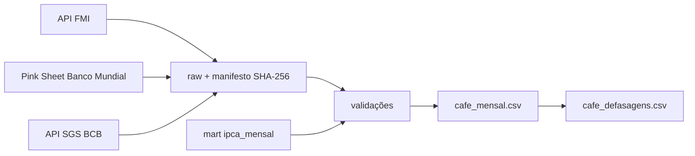

# Projeto: piloto do café — mercado internacional e consumidor

- **Issue:** [#62](https://github.com/marcelo7bastos/macroeconomia-agricultura-familiar/issues/62).
- **Situação:** implementado em 04/11/2026, em revisão no PR. Pendências de licença (FMI e Banco
  Mundial) e Conab descritas abaixo.
- **Decisão:** [ADR 0009](../decisoes/0009-fontes-de-precos-do-cafe.md).
- **Escopo de índice:** só o **IPCA** (jul/2006 → atual). O IPCA-15 fica fora do piloto.

## Pergunta do piloto

Como o preço internacional do café se relaciona com o preço pago pelo consumidor no IPCA? Em
quanto tempo e em que proporção uma alta ou uma queda chega ao café moído?

Se o desenho funcionar, ele se repete para outros produtos (arroz, feijão, leite, carne, açúcar).

## O que foi entregue

| Peça | Onde |
|---|---|
| Catálogo | `config/precos.yaml` |
| Coleta | `uv run python -m macroaf.cafe.extrair` (`--verificar` só lista) |
| Raw | `data/raw/{bcb_sgs,fmi_pcps,banco_mundial_cmo}/` com `manifesto.csv` |
| Validação, indicadores e publicação | `uv run python -m macroaf.cafe.publicar` |
| Marts | `data/marts/cafe_mensal.csv`, `data/marts/cafe_defasagens.csv`, dicionário `data/marts/cafe_README.md` |
| Metadados | chave `cafe` em `data/metadata.json` |
| Exceções contadas | `reference/excecoes_validacao_cafe.csv` |
| Atualização automática | job `cafe` em `.github/workflows/atualizacao.yml`, depois dos índices |
| Explicação para gestores | `docs/gestao/cafe.html`, gerada por `uv run python -m macroaf.relatorios.gestao --indice cafe` |
| Testes | `tests/test_cafe.py` e `tests/test_gestao.py` |
| Método | [METODOLOGIA.md, seção 15](../METODOLOGIA.md) |

## Séries

| `serie` | Fonte | Unidade original | No mart desde |
|---|---|---|---|
| `cafe_arabica_fmi` | FMI, `PCOFFOTM` (Other Mild Arabica) | US¢/lb | jul/2006 |
| `cafe_robusta_fmi` | FMI, `PCOFFROB` (Robustas) | US¢/lb | jul/2006 |
| `cafe_arabica_bm` | Banco Mundial, `Coffee, Arabica` (OIC) | US$/kg | jul/2006 |
| `cafe_robusta_bm` | Banco Mundial, `Coffee, Robusta` (OIC) | US$/kg | jul/2006 |
| `ipca_cafe_moido` | IPCA, subitem 1114022 | — | jul/2006 |
| `ipca_cafe_soluvel` | IPCA, subitem 1114023 | — | jul/2006 |
| `ipca_cafezinho` | IPCA, subitem 1201009 | — | jul/2006 |
| `ipca_cafe_da_manha` | IPCA, subitem 1201005 (até dez/2019) | — | jul/2006 |
| `ipca_geral` | IPCA, índice geral (deflator) | — | jul/2006 |

Câmbio: PTAX venda, média mensal calculada da série diária SGS 1 e validada contra a SGS 3698.
FMI e Banco Mundial publicam médias mensais; por isso "o câmbio do dia da informação" é a média
mensal da PTAX (ver a metodologia).

## Primeiros resultados (dados até set/2026)

- Em 12 meses até set/2026: arábica em R$ −20,8% (FMI), robusta −23,8%, café moído no IPCA
  −17,8% e cafezinho +9,8%.
- A correlação entre a variação mensal do arábica (em R$) e a do café moído é maior com **3 a 4
  meses de defasagem** (≈ 0,33–0,34, contra 0,09 no mesmo mês); no acumulado em 12 meses, ≈ 0,62
  com 4 a 5 meses. Leitura descritiva, sem causalidade.
- Razão consumidor/preço em set/2026: 75 (arábica) — desde jun/2006 o café moído subiu menos que
  o arábica em reais.

## Pendências antes de integrar

1. **Licença do FMI:** a resposta da API declara "All Rights Reserved" e remete a
   <https://www.imf.org/external/terms.htm>, que não pôde ser lido na sessão. Confirmar que os
   termos permitem republicar os valores; se não, o mart fica só com o Banco Mundial.
2. **Licença do Banco Mundial:** confirmar CC BY 4.0 na página do conjunto de dados.
3. **Regra do `AGENTS.md`** sobre as APIs usadas foi estendida neste PR: precisa da revisão do
   mantenedor.

## Fontes futuras

- **Conab** (preços recebidos pelo produtor, por UF, em R$): o portal de dados responde com
  certificado TLS de outro domínio e o site institucional redireciona para `www.gov.br`, fora da
  rede da sessão (A-039). Entra quando o acesso funcionar com TLS válido.
- **CEPEA/Esalq** (arábica posto São Paulo e robusta no Espírito Santo, diários, R$/saca): a
  referência do mercado físico brasileiro. Sem API, bloqueia acesso automatizado e agentes de IA
  e usa licença CC BY-NC 4.0 (A-038). Pode entrar se o CEPEA autorizar o acesso automatizado,
  num mart com licença própria.

## Próximas etapas

| Etapa | Entrega |
|---|---|
| Conab | quando o acesso funcionar |
| Ligação com a agricultura familiar | participação da agricultura familiar na produção de café (Censo Agro 2017, SIDRA) |

## Fora do escopo do piloto

- IPCA-15, recortes regionais do IPCA e outros produtos.
- Bolsas (ICE Nova York e Londres) e preços futuros.
- Atribuição de causa ao repasse e previsão de preço.

## Cuidados de leitura

- Café moído é produto industrializado (torra, embalagem, marca) e mistura tipos; os preços
  internacionais são de café verde exportado. Razões mostram direção e defasagem, não margem.
- O IBGE não publica a composição do café moído entre arábica e robusta: séries separadas, sem
  cesta inventada.
- FMI e Banco Mundial divergem acima de 1% em quatro meses desde 2006 (A-036): exceções
  registradas, sem ajuste.
