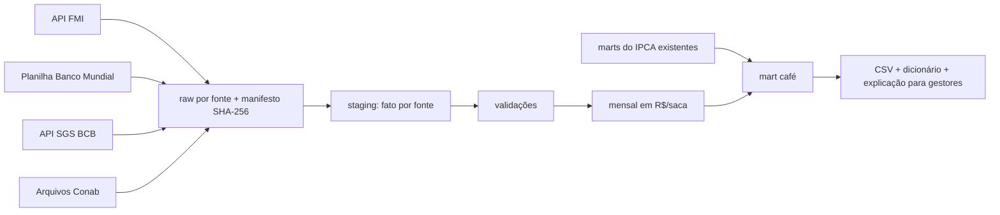

# Projeto: piloto do café — do produtor e do mercado internacional ao consumidor

- **Issue:** [#62](https://github.com/marcelo7bastos/macroeconomia-agricultura-familiar/issues/62).
- **Situação:** direção aprovada pelo mantenedor em 04/11/2026; implementação pendente
  de acesso às fontes. Identificadores das séries marcados *a confirmar* ainda não foram consultados.
- **Data do levantamento:** 04/11/2026.
- **Escopo de índice:** só o **IPCA** (jul/2006 → atual). O IPCA-15 fica fora do piloto.

## Pergunta do piloto

Como o preço do café no mercado internacional e o preço recebido pelo produtor brasileiro se
relacionam com o preço pago pelo consumidor no IPCA? Em quanto tempo e em que proporção uma alta
ou uma queda chega ao café moído?

O café serve de piloto porque tem os três lados medidos por fontes públicas com acesso
automatizável. Se o desenho funcionar, ele se repete para outros produtos (arroz, feijão, leite,
carne, açúcar).

## Lado do consumidor: o que já existe (IPCA)

| Subitem | Código IBGE | Período | Observação |
|---|---|---|---|
| Café moído | 1114022 | jul/2006 → | peso 0,53% em set/2026; o elo principal do piloto |
| Café solúvel | 1114023 | jul/2006 → | peso pequeno (~0,01%) |
| Cafezinho | 1201009 | jul/2006 → | alimentação fora do domicílio; serviço, comparação só descritiva |
| Café da manhã | 1201005 | até dez/2019 | descontinuado; não emendar |

Os quatro aparecem como `identico` nas trocas de POF de `reference/map_harmonizacao_ipca.csv`;
não há quebra a tratar no café além da descontinuação do café da manhã. Nada é recalculado: o
piloto lê os marts do IPCA (`ipca_mensal.csv`, `ipca_categorias.csv`).

## Lados do mercado e do produtor: fontes novas

| Fonte | Série | Unidade | Frequência | Acesso | Licença |
|---|---|---|---|---|---|
| FMI — Primary Commodity Prices (PCPS) | café arábica (Other Mild Arabica) e robusta; códigos `PCOFFOTM` e `PCOFFROB` *a confirmar* | US¢/libra-peso | mensal (média do mês) | API SDMX do FMI | termos do FMI *a confirmar* |
| Banco Mundial — Pink Sheet (CMO) | café arábica e robusta | US$/kg | mensal (média do mês), desde 1960 | planilha histórica em URL estável | CC BY 4.0 *a confirmar* |
| Banco Central — SGS | dólar PTAX venda, diário (série 1) e média mensal (série 3698) *a confirmar* | R$/US$ | diária e mensal | API SGS | dado público |
| Conab — preços agropecuários | café arábica e conilon recebidos pelo produtor, por UF | R$/saca de 60 kg | semanal e mensal *a confirmar* | arquivos de dados do Portal de Informações *a confirmar* | dado público |

FMI e Banco Mundial publicam a mesma família de preços (cotações internacionais de referência);
os dois entram porque um confere o outro: a diferença entre eles, depois da conversão de unidade,
vira validação.

**Possível fonte futura: CEPEA/Esalq.** Os indicadores diários de arábica (posto em São Paulo) e
robusta (Espírito Santo), em R$/saca de 60 kg, são a referência do mercado físico brasileiro. Ficam
fora do piloto porque o site não tem API, o `robots.txt` bloqueia agentes e crawlers, as páginas
de série recusam acesso automatizado e a licença é CC BY-NC 4.0 (o projeto publica em CC BY 4.0).
Podem entrar depois, num mart com licença própria, se o CEPEA autorizar o acesso automatizado.

## Conversão cambial

A instrução do mantenedor é converter pelo câmbio do Banco Central **do dia da informação**:

- **FMI e Banco Mundial** publicam médias mensais, sem dia. O equivalente correto é a **média
  mensal da PTAX venda** do mesmo mês: média dos dias úteis da série diária, conferida contra a
  média mensal que o próprio BCB publica (validação contra referência oficial).
- **Preços diários ou semanais** que vierem em US$ (nenhum no piloto) usam a PTAX do próprio dia;
  em dia sem PTAX (fim de semana, feriado), a do último dia útil anterior, com marca na linha.
- **Conab** já publica em R$: não há conversão.

Conversões de unidade, todas explícitas no código e testadas:
US¢/lb → US$/kg (÷ 100 × 2,20462262) e US$/kg → R$/saca de 60 kg (× PTAX × 60).

## Arquitetura

| Camada | Contrato |
|---|---|
| Catálogo | `config/series.yaml`: fontes `imf_pcps`, `banco_mundial_cmo`, `bcb_sgs`, `conab_precos`, cada uma com URL, licença e ficha. O esquema atual só conhece índices SIDRA: estender com uma seção de séries de preços, sem mudar a dos índices |
| Raw | `data/raw/<fonte>/<serie>/<AAAAMMDD>.<ext>.gz`, corpo exato da resposta, revisões sem sobrescrever, manifesto com URL, coleta e SHA-256 (decisão 0003) |
| Leitores | `src/macroaf/extract/{imf,banco_mundial,bcb,conab}.py`; um cliente HTTP só (`extract/cliente.py`) |
| Fato | `data/staging/cafe/fato_precos.parquet`: `periodo`, `frequencia`, `fonte`, `serie`, `praca`, `valor`, `unidade` — valores como vieram, sem conversão |
| Câmbio | `data/staging/cafe/cambio.parquet`: PTAX diária e média mensal calculada, com a média oficial ao lado |
| Mensal | `data/staging/cafe/precos_mensais.parquet`: tudo em R$/saca de 60 kg e em US$/kg, com origem e fator de conversão por linha |
| Consumo | `data/marts/cafe_mensal.csv` (nome estável); dicionário e chave `cafe` em `data/metadata.json` |

Os marts do IPCA não mudam. O mart do café só os lê.

### Validações (falha = não publicar)

- Chave única por `(periodo, fonte, serie, praca)`; valores positivos; meses sem lacuna no
  intervalo de cada série, ou lacuna registrada.
- **Câmbio:** média mensal calculada da PTAX diária igual à média mensal oficial do BCB, na
  tolerância de arredondamento publicada.
- **FMI × Banco Mundial:** depois da conversão de unidade, a diferença entre as duas fontes fica
  dentro de um limite documentado em `reference/limites_validacao_cafe.csv`; divergência vira
  diagnóstico, não ajuste.
- **Conab:** a média mensal calculada das semanas confere com a mensal publicada, se a Conab
  publicar as duas.
- **Arquivo novo contém o anterior:** revisões de valores já coletados são registradas, nunca
  sobrescritas em silêncio.
- **IPCA:** o mart do café repete exatamente os valores do café moído de `ipca_mensal.csv`.

### Indicadores do mart (cálculos do projeto, marcados como tal)

| Indicador | Definição | Teste |
|---|---|---|
| Preço internacional em R$/saca | média mensal US$/kg × PTAX média × 60 | identidade com os fatores |
| Variação mensal e acumulada em 12 meses de cada preço | sobre a média mensal | identidade com o produto de (1 + v) |
| Índice base 100 comum | produtor, internacional e café moído no mesmo mês-base | volta às variações de origem |
| Preço real | preço em R$ deflacionado pelo IPCA geral | identidade com o índice do IPCA geral |
| Razão consumidor/produtor e consumidor/internacional | índice do café moído ÷ índice do preço | identidade algébrica; leitura de direção, não de margem em R$ |
| Correlação com defasagem | entre a variação do preço no mês t−k e a do café moído no mês t, k = 0…12 | descritiva, reproduzível; **sem leitura causal** |

## Etapas (uma issue por etapa, ou uma issue com estas tarefas)

| Etapa | Entrega | Aceite |
|---|---|---|
| 0 | Fichas `docs/fontes/{imf,banco-mundial,bcb-sgs,conab}.md` com séries, unidades, períodos e licenças confirmados | identificadores conferidos na fonte |
| 1 | Extração com raw e manifesto para as quatro fontes; testes com respostas reais gravadas | rodada idempotente: segunda execução não grava nada |
| 2 | Staging, câmbio e validações | todas as validações verdes |
| 3 | Mart `cafe_mensal.csv`, dicionário e indicadores | testes de identidade de todos os indicadores |
| 4 | Atualização automática no Actions (entrada `cafe` no `atualizacao.yml`) | commit só se tudo passa |
| 5 | Explicação para gestores `docs/gestao/cafe.html` | mesmo padrão das páginas do IPCA |

## Fora do escopo do piloto

- IPCA-15, recortes regionais do IPCA e outros produtos.
- Bolsas (ICE Nova York e Londres) e preços futuros.
- CEPEA, até haver autorização de acesso automatizado.
- Participação da agricultura familiar na produção de café (Censo Agro 2017, no SIDRA): fase
  seguinte, que liga o piloto ao tema do projeto.
- Atribuição de causa ao repasse e previsão de preço.

## Riscos

- **Comparação imperfeita.** Café moído é produto industrializado (torra, embalagem, marca) e
  mistura tipos; os preços internacionais são de café verde exportado, não do grão vendido no
  mercado interno. A razão entre índices mostra direção e defasagem, não margem.
- **Arábica × robusta.** O IBGE não publica a composição do café moído. As séries ficam separadas;
  nenhuma cesta é inventada.
- **Atraso de publicação.** FMI e Banco Mundial publicam o mês no início do mês seguinte; a Conab
  tem calendário próprio. O mart informa até quando vai cada série.
- **Mudança de formato da planilha do Banco Mundial ou dos arquivos da Conab.** O leitor falha com
  mensagem clara, sem adivinhar colunas.
- **Regra do `AGENTS.md`.** As APIs listadas lá são só as do IBGE. Incluir FMI, Banco Mundial,
  BCB e Conab muda essa regra e exige PR revisado pelo mantenedor (pode ser o PR deste piloto).
