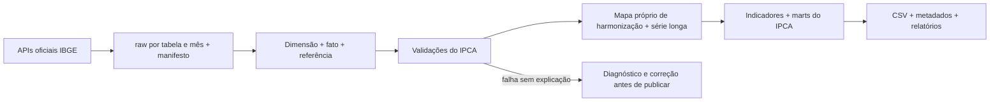

# Projeto: preparar os dados do IPCA geral

- **Issue de referência:** [#12 — Fonte: IPCA cheio](https://github.com/marcelo7bastos/macroeconomia-agricultura-familiar/issues/12).
- **Situação:** entrega principal implementada, em revisão no PR #58; catálogo IPCA ativado.
- **Data do levantamento:** 20/10/2026.
- **Plano de tarefas para o GitHub Projects:** [tarefas.json](ipca-geral/tarefas.json).
- **Fonte técnica:** [ficha do IPCA](../indices/ipca.md) e [IBGE/SIDRA](../fontes/ibge-sidra.md).

## Resultado esperado

Disponibilizar uma base mensal auditável do **IPCA cheio, Brasil (N1)**: índice geral e sua
classificação própria até subitem, incluindo alimentação e bebidas, alimentação no domicílio
e fora do domicílio. O objetivo é preparar os dados para análise e painéis; a criação de um
painel ou de um indicador específico da agricultura familiar é outra entrega.

**Entrega principal:** julho/2006 até o último mês completamente publicado pelo IBGE, com as
POFs 2002-03, 2008-09 e 2017-18. Em 20/10/2026, os metadados consultados terminam em setembro/2026.
O fim da série permanece dinâmico: não fixar setembro no código nem prever meses futuros.

**Primeira prova de funcionamento:** janeiro/2020 até o último mês disponível. Essa prova reduz
as variáveis da primeira execução; não encerra a entrega principal. O histórico anterior a
julho/2006 é uma extensão explícita, condicionada ao tratamento de tabelas complementares.

O IPCA não substitui o IPCA-15. Ambos coexistem com códigos de índice, saídas e validações
próprios; a base já publicada do IPCA-15 precisa continuar funcionando.

## Cobertura e fontes

| Papel | Tabela SIDRA | Período conferido | Tratamento planejado |
|---|---|---|---|
| Dados detalhados | 7060 | jan/2020–set/2026, aberta | Prova inicial e série corrente |
| Dados detalhados | 1419 | jan/2012–dez/2019 | Retrocarga da entrega principal |
| Dados detalhados | 2938 | jul/2006–dez/2011 | Retrocarga da entrega principal |
| Referência oficial do geral | 1737 | dez/1979–set/2026, aberta | Validar os resultados no intervalo comum |
| Extensão histórica: variação | 655 | ago/1999–jun/2006 | Compor com 656 e 657, após decisão de esquema |
| Extensão histórica: peso | 656 | ago/1999–jun/2006 | Complemento, não sucessora da 655 |
| Extensão histórica: acumulado no ano | 657 | ago/1999–jun/2006 | Complemento, não sucessora da 656 |

Datas, variáveis, categorias e peculiaridades ficam documentadas na ficha. O levantamento de
metadados e amostras não equivale à extração integral nem à validação do histórico.

Variáveis do IPCA: `63` → `variacao_mensal`, `69` → `variacao_acum_ano`, `66` → `peso`,
`2265` → `variacao_acum_12m`; na referência, `2266` → `numero_indice`, `2263` →
`variacao_acum_3m` e `2264` → `variacao_acum_6m`, além das variáveis comuns. Confirmar a
presença e a disponibilidade efetiva por tabela e mês, preservando os sinais da fonte.

As trocas de POF do IPCA ocorrem um mês antes das do IPCA-15. Não reaproveitar suas datas,
árvore de categorias ou contagens de exceções. A tabela 7060 tem 377 subitens; a 7062 do
IPCA-15 tem 367, segundo o levantamento do projeto.

## Arquitetura e contratos



Reutilizar catálogo, cliente HTTP, raw, classificação, transformações e indicadores onde o
contrato já é genérico. Alterar código compartilhado apenas diante de uma diferença demonstrada,
com regressão para o IPCA-15. Não duplicar o pipeline inteiro nem criar um agente por índice.

| Camada | Contrato da implementação |
|---|---|
| Catálogo | Entrada `ipca`, tabela, variáveis, período e POF oficiais; campos semânticos iguais aos existentes |
| Raw | `data/raw/ibge_sidra/<tabela>/<AAAAMM>.json.gz`, metadados e manifesto com URL, coleta e SHA-256 |
| Classificação | `data/staging/ipca/dim_classificacao.parquet`; hierarquia pelo código IBGE, nunca pelo campo `nivel` |
| Fato | `data/staging/ipca/fato_ipca.parquet`; chave `(mes, tabela_sidra, codigo_sidra)`, Brasil |
| Referência | `data/staging/ipca/ref_ipca_geral.parquet`; cobertura da 1737 separada da cobertura do detalhe |
| Validação | `data/staging/ipca/validacao.json`; falhas e exceções contadas, sem publicar resultado inválido |
| Harmonização | `reference/map_harmonizacao_ipca.csv`; revisão humana preservada e quebras explícitas |
| Série longa | `data/staging/ipca/serie_longa_ipca.parquet`; não emendar categoria incerta |
| Consumo | `data/marts/ipca_{categorias,mensal,acumulados,contribuicoes,difusao}.csv` e chave `ipca` em `data/metadata.json` |
| Documentação | Páginas `docs/transformacoes/ipca.html` e `docs/revisao/harmonizacao_ipca.html`, com referências corretas ao IPCA |

As saídas de consumo são parte da entrega ponta a ponta, depois da preparação e validação do
staging. Nenhuma saída será declarada pronta apenas porque um comando terminou sem erro.

## Lacunas técnicas a resolver

1. **Cobertura da referência:** a 1737 começa em 1979, antes do detalhe. A checagem atual exige
   que o início cadastrado coincida com os metadados; portanto, não cadastrar um início fictício
   em 2020 ou 2006 para a 1737. Separar cobertura original, janela de extração e intervalo usado
   na validação. Não exigir igualdade de índices de datas fora da interseção pertinente.
2. **Tabelas complementares anteriores a 2006:** o esquema atual exige sucessão sem sobreposição
   e uma POF por tabela de dados. 655, 656 e 657 se sobrepõem na mesma POF; não cabem como três
   tabelas sucessivas. Modelar composição e junção por mês/categoria antes de ativar essa extensão.
3. **Referências e exceções:** criar `excecoes_validacao_ipca.csv` e
   `limites_validacao_ipca.csv` com esquema válido; começar sem exceções não comprovadas.
   Não copiar os desvios, casos de cesta variável ou contagens do IPCA-15 por analogia.
4. **Relatórios:** há referências editoriais à 3065, 1117, 355, 356, leite e trocas do IPCA-15
   em `macroaf.relatorios.coleta` e `transformacoes`. Parametrizar os conteúdos e exemplos
   necessários para não publicar uma página de IPCA com explicações do índice errado.
5. **Operação:** o workflow de atualização fixa `ipca15` no comando, leitura de metadados e
   mensagem de commit. Generalizar a seleção de índice e evitar dois jobs gravando na `main`
   ao mesmo tempo, sem misturar sucesso de um índice com falha de outro.

Os módulos que hoje se chamam `transform.ipca15` e `validate.ipca15` já recebem um índice em
parte das interfaces. O nome do módulo não é, sozinho, motivo para uma grande renomeação;
verificar a semântica e manter compatibilidade dos comandos existentes.

## Etapas, dependências e critérios de aceite

| ID | Entrega | Dependências | Aceite principal |
|---|---|---|---|
| IPCA-01 | Descoberta oficial e ficha | — | Metadados, períodos e amostras dos marcos conferidos; cobertura e ausências explícitas |
| IPCA-02 | Catálogo e cobertura da referência | 01 | `ipca` válido no catálogo, sem forjar datas da 1737; testes do IPCA-15 continuam válidos |
| IPCA-03 | Extração incremental e raw auditável | 02 | Retomada, reexecução e revisão sem duplicação; manifesto íntegro e volume de chamadas registrado |
| IPCA-04 | Classificação, fato e referência | 03 | Staging tipado, sem chaves repetidas nem conversão silenciosa de ausentes em zero |
| IPCA-05 | Validações e diagnóstico do IPCA | 04 | Referências oficiais e identidades passam; erros injetados são detectados |
| IPCA-06 | Prova ponta a ponta da série corrente | 05 | 2020+ vai de raw a saída revisada; 2026 contém só meses efetivamente publicados |
| IPCA-07 | Retrocarga até jul/2006 e harmonização | 06 | Três POFs cobertas sem lacunas; continuidades revisadas e quebras preservadas |
| IPCA-08 | Indicadores e contratos de consumo | 07 | Marts, metadados e relatórios consistentes, incluindo alimentos dentro/fora de casa |
| IPCA-09 | Atualização automática e aceite final | 08 | Novo mês, revisão, ausência de novidade e falha da fonte testados sem regressão do IPCA-15 |
| IPCA-10 | Extensão ago/1999–jun/2006 | 09 | Decisão de composição aprovada antes da extração; pesos, variação e acumulado unidos sem duplicação |

IPCA-01 inclui o levantamento inicial realizado neste planejamento, mas permanece pendente de
aceite completo e das amostras que estiverem explicitamente em aberto na ficha. Nenhum cartão
será marcado concluído apenas por ter sido criado no quadro.

### Verificações obrigatórias

- Integridade do raw e dos manifestos, contagens por tabela/mês e ausência de lacunas no recorte.
- Esquema, categorias sem pai, chaves únicas e cinco níveis hierárquicos corretamente derivados.
- Pesos, reconciliação, continuidade, acumulados e índice geral confrontados com o publicado.
- Testes específicos dos marcos jun/2006→jul/2006, dez/2011→jan/2012 e dez/2019→jan/2020,
  conforme a cobertura efetivamente ativada. Sem amostra anterior disponível, declarar o teste
  ainda não executado em vez de tratá-lo como aprovado.
- Nulos e sinais especiais preservados; validações de qualidade não substituídas pela tolerância
  de comparação entre ambientes.
- Na comparação de publicações: diferença absoluta máxima inclusiva de **0,001 p.p.** apenas
  para acumulados calculados e contribuições; oficiais, códigos, datas, textos, estrutura e
  ausentes exatos. Cada hash confere com seu próprio CSV (A-031).
- Meses sem novidade não alteram arquivos; revisões ficam auditáveis; falha bloqueia a publicação
  do índice afetado. Recuperação após falha testada com procedimento documentado.
- `uv run ruff check .`, `uv run ruff format --check .` e suíte relevante, sem zerar ou pular
  verificações do IPCA-15 para incluir o IPCA.
- Revisão metodológica antes de cada PR e validação de dados antes de publicar marts.

## Organização do GitHub Projects

**Título:** IPCA geral — preparação dos dados.

A issue #12 permanece como referência da frente. Criar dez issues de trabalho com os IDs acima,
inseri-las no projeto e vincular o projeto ao repositório. Os corpos dos cartões contêm escopo,
dependências, critérios de aceite e referência à #12. Todos começam no backlog; a priorização
e o início de cada implementação ficam explícitos no quadro.

Usar a visualização Board agrupada por **Status** (A fazer / Em andamento / Concluído, ou os
nomes equivalentes da conta). Bloqueios e revisão ficam registrados nos cartões até a equipe
optar por ampliar os estados. Manter IPCA-10 separado da definição de pronto da entrega principal.

O publicador [publicar.py](ipca-geral/publicar.py) começa em modo de simulação, não armazena
credenciais e reutiliza projeto e issues pelos identificadores, sem criar duplicatas em uma
retomada. A API e as permissões de Projects precisam funcionar antes de aplicá-lo:

```bash
python docs/projetos/ipca-geral/publicar.py
python docs/projetos/ipca-geral/publicar.py --aplicar
```

O publicador reutiliza a autenticação do `gh`. Se houver uma credencial específica
`GH_PROJECTS_TOKEN`, usa-a somente no processo filho do CLI, sem salvar ou imprimir seu valor.
Ela precisa autorizar leitura/escrita em Projects e Issues do repositório. Cadastre valores
somente nas configurações seguras do ambiente; nunca no JSON, nos arquivos ou no chat. A
integração GitHub que permite clonar e fazer push não garante permissão de Projects.

O publicador cria os itens e o vínculo ao repositório. A seleção de layout Board e o agrupamento
por Status são ajustes de apresentação feitos na interface do GitHub Projects; não se confundem
com a criação dos itens. No caso de falta de acesso, preservar o plano e os cartões preparados,
registrar o bloqueio e retomar a publicação sem recriar o que já existe.

## Implementação e limites

A entrega principal foi extraída, transformada e validada: 805 respostas mensais oficiais,
243 meses de detalhe e 111.299 observações, de julho/2006 a setembro/2026. Os cinco marts e seu
dicionário estão em `data/marts/ipca_*`; a explicação auditável está em
[`../transformacoes/ipca.html`](../transformacoes/ipca.html). As saídas do IPCA-15 foram preservadas.

As 63 propostas de harmonização pendentes continuam marcadas como quebras até revisão humana.
A atualização automática dos dois índices depende do merge e da primeira execução conferida no
GitHub Actions. A publicação do quadro no GitHub Projects continua bloqueada pela permissão da
integração; o plano e os cartões estão preparados para retomada, sem bloquear o pipeline.

A extensão anterior a julho/2006 (IPCA-10) permanece separada. A entrega não inclui recortes
regionais, INPC, IPCA-E, dessazonalização, previsões, painel ou definição de uma cesta da
agricultura familiar. Esses temas exigem escopo e critérios próprios.
